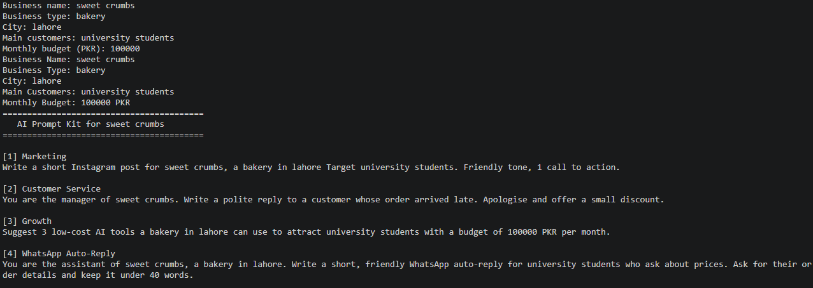

**Name:** Muhammad Ahmad Raza
**Course Nmae:** Pyhton for AI
**AI Goal:** TO become an AI Engineer


## How to Run
Run any script using `uv`:
```bash
uv run code/lesson_01_intro.py
```


## Module 1 Project: AI Prompt Kit

A Python tool that turns a local business's details into 3 ready-to-use AI prompts.

**Run:** `uv run code/project_m1_prompt_kit.py`



**Who would pay for this:** small shop owners who want AI help but don't know what to type and how to give prompt to AI.


## Task 1.8: Sweet Crumbs Bakery Bot (Design)

| Intent | Keywords | Reply |
|---|---|---|
| Complaint | refund, complaint, late (whole words only) | A manager will call you within 1 hour |
| Opening hours | hour, open, timing, time | Open 9 am to 10 pm, every day |
| Prices | price, cost, how much | Cakes from 1,500 PKR, cupcakes 250 PKR |
| Location | where, location, address | Main Boulevard, Lahore |
| Orders and delivery | order, delivery | Order on WhatsApp, free delivery over 3,000 PKR |
| Greeting | hi, hello (exact match), salam (starts with) | Hello and a short offer to help |
| Human handover | agent, human | Connecting you to a human... |

**Run:** `uv run code/lesson_08_mini_chatbot.py`